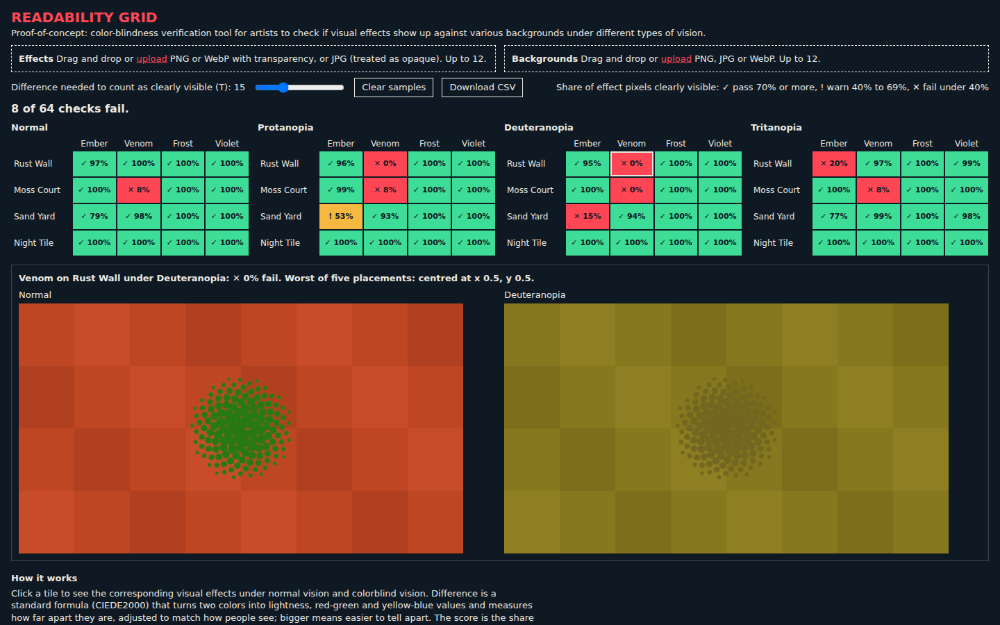

# Readability Grid

Readability Grid checks every effect image against every background image, under normal vision and three kinds of colour blindness, and shows in one grid which pairs are hard to see.



## Who it is for

Artists who make effects and environments for a game. VALORANT's colour-blind option changes only the enemy outline colour, so player settings do not cover effects and skins. Unreal's editor can already preview one image under colour blindness, but 12 effects against 12 backgrounds under 4 kinds of vision is 576 views, which nobody can check by eye. This page tells an artist where to look. It does not replace looking.

## How to run it

You need Node 22.

```
npm start
```

Then open http://localhost:8000. The samples are already in the grid. Drop your own images on the two boxes to add them. Everything runs in the browser and nothing is uploaded.

To run the checks:

```
npm test
npm install
npm run smoke
```

`npm test` needs no install. `npm run smoke` needs Playwright and its Chromium (`npx playwright install chromium` if it is missing), and it rewrites `docs/screenshot.png`.

## How it works

Each effect is shrunk so its longest side is at most 128 px, and each background is resized to 512 px wide. The effect is then placed at the background's centre and at its four quarter points. For each effect pixel that is at least half opaque, the page composites it over the background, simulates the chosen vision on both the result and the bare background (matrices from Machado et al. 2009), and measures the difference between them with CIEDE2000. A placement's score is the share of pixels with a difference of at least `T`, and a cell's score is the lowest of its five placements. A cell passes at 70% or more, warns from 40% to under 70%, and fails under 40%. Clicking a cell shows its worst placement under normal vision beside the chosen vision.

## Known limits

- `T` (default 15) and the pass and fail lines are judgment calls. They are not calibrated against a human study. For scale, 2.3 is the usual just-noticeable difference, and 15 is a rough guess at "clearly different at a glance". The slider shows how much a result depends on `T`.
- It compares colours pixel by pixel, so it knows nothing about shape, motion or how large an effect is on screen. Video and animated effects are not supported.
- The simulation covers full colour blindness only, not milder forms.
- Images are resized with nearest neighbour and composited in linear light, which may not match how a game engine draws the same effect.
- The sample images are drawn in code, and their colours were tuned so that Venom on Rust Wall shows the problem. They do not come from a real game.
- A full 12 by 12 grid took about 13 seconds on the machine it was built on. With more than about 8 effects, each grid scrolls sideways and column names are cut off (hover to read the full name).
